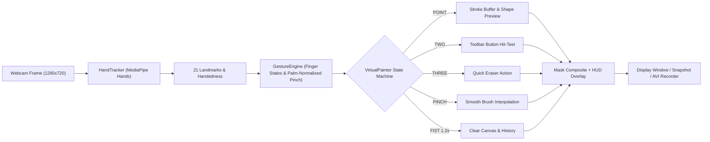

<div align="center">

# 🎨 Air Canvas Pro

**Real-Time Touchless Virtual Drawing & Gesture-Controlled Canvas powered by Computer Vision**

<p align="center">
  
  
  
  
  
</p>

<p align="center">
  <b>Draw, sketch shapes, switch tools, adjust brush size, and record your artwork in mid-air using nothing but your hands and a webcam.</b>
</p>

</div>

---

## 📌 Overview

**RUSHX Air Canvas Pro** is an interactive, real-time computer vision drawing application built with **Python**, **OpenCV**, and **Google MediaPipe**. By tracking 21 3D hand landmarks per hand at high frame rates, the engine translates natural finger gestures into drawing strokes, geometric shapes, dynamic brush sizing, tool selections, and canvas actions without touching a mouse or screen.

Designed for smooth performance, it features **moving-average stroke smoothing**, **stamp-interpolated continuous lines**, **multi-hand tracking** (up to 2 hands simultaneously), **full stroke history (Undo)**, **live video recording**, and **dual-layer snapshot exports**.

---

## ✨ Key Features

- 🖐️ **Dual-Hand 21-Landmark Tracking** — Powered by MediaPipe Hands with automatic Left/Right handedness classification.
- 🖌️ **Smooth Freehand Drawing** — 6-point deque smoothing buffer combined with dense circle-stamp interpolation eliminates gaps during fast hand movements.
- 📐 **Interactive Shape Mode** — Draw live-previewed **Lines**, **Rectangles**, and **Circles** in mid-air before committing them to the canvas.
- 🤏 **Dynamic Pinch Brush Sizing** — Scale brush thickness smoothly (`2px` – `50px`) by pinching your thumb and index finger, normalized by palm scale so it works at any distance from the camera.
- 🎨 **Interactive On-Screen Toolbar** — Hover with two fingers to pick from **8 vibrant colors**, **5 brush presets**, **Pen / Eraser / Shape modes**, **Undo**, **Clear**, and **Save**.
- ⏪ **Action-Based Undo History** — Every pen stroke, erase action, and geometric shape is recorded as a vector action so undoing reconstructs the canvas cleanly.
- 🎥 **Built-In Video Recorder & Dual Snapshot Saver** — Record your live drawing session to `.avi` video or save both the raw artwork (`canvas_*.png`) and webcam composite (`scene_*.png`) with a single key or button tap.
- 📊 **Live HUD & Status Bar** — Real-time badges for Tracking, Draw, Erase, Shape, Recording, Active Hand Count, and FPS counter, plus an on-screen toggleable Help overlay.

---

## 🖐️ Hand Gesture Controls

| Gesture | Fingers Up | Action | Description |
| :--- | :---: | :--- | :--- |
| ☝️ **Point** | `1 Finger` (Index) | **Draw / Active Tool** | Draws freehand strokes, erases (if Eraser tool is active), or drags a live geometric shape (if Shape mode is `ON`). |
| ✌️ **Two Fingers** | `2 Fingers` (Index + Middle) | **Toolbar Select** | Moves the selection cursor (`Yellow`) to click buttons on the top toolbar without drawing on the canvas. |
| 🤟 **Three Fingers** | `3 Fingers` (Index + Middle + Ring) | **Quick Erase** | Instantly erases canvas content under your index fingertip with an enlarged eraser brush. |
| 🤏 **Pinch** | `Thumb + Index Close` | **Dynamic Brush Size** | Adjusts brush thickness dynamically based on the palm-normalized distance between thumb and index tips. |
| 🖐️ **Open Palm** | `5 Fingers` | **Pause / Hover** | Pauses drawing and finishes the current stroke so you can reposition your hand freely. |
| ✊ **Fist Hold** | `0 Fingers` (Hold `1.2s`) | **Clear Canvas** | Hold a closed fist for `1.2 seconds` to wipe the entire canvas and reset stroke history. |

---

## ⌨️ Keyboard Shortcuts

| Key | Action |
| :---: | :--- |
| `p` | Switch to **Pen** tool |
| `e` | Switch to **Eraser** tool |
| `m` | Toggle **Shape Mode** (`ON` / `OFF`) |
| `l` | Select **Line** shape |
| `b` | Select **Rectangle (Box)** shape |
| `o` | Select **Circle** shape |
| `1` – `5` | Select **Brush Size Preset** (`4`, `8`, `14`, `22`, `32`) |
| `z` | **Undo** last stroke or shape |
| `c` | **Clear** entire canvas |
| `s` | **Save** snapshot (`canvas_*.png` & `scene_*.png` inside `captures/`) |
| `r` | Start / Stop **Video Recording** (`record_*.avi` inside `captures/`) |
| `h` | Toggle on-screen **Help & Shortcuts** overlay |
| `q` | **Quit** application safely |

---

## 🏗️ System Architecture



---

## 📁 Project Structure

```text
Air-Canvs-pro-1/
├── hand_track.py        # Main application (HandTracker, GestureEngine, VirtualPainter UI)
├── requirements.txt     # Minimal Python dependencies (opencv-python, mediapipe, numpy)
├── README.md            # Project documentation
├── LICENSE              # MIT License
├── .gitignore           # Ignored virtualenvs, cache files, and media captures
├── .gitattributes       # Line-ending normalization
└── captures/            # Auto-created folder for saved PNG snapshots & AVI recordings
```

---

## 🚀 Getting Started

### 1. Prerequisites
- **Python 3.8 – 3.12** installed on your system
- A working **Webcam** (built-in or USB)

### 2. Clone the Repository
```bash
git clone https://github.com/RanithuDewage/Air-Canvs-pro-1.git
cd Air-Canvs-pro-1
```

### 3. Create a Virtual Environment (Recommended)
```bash
# Windows (PowerShell)
python -m venv venv
.\venv\Scripts\Activate.ps1

# macOS / Linux
python3 -m venv venv
source venv/bin/activate
```

### 4. Install Dependencies
```bash
pip install -r requirements.txt
```

### 5. Run the Application
```bash
python hand_track.py
```

---

## 💡 Tips for Best Tracking Accuracy

1. **Lighting**: Use even front-facing lighting so your hand silhouette and finger joints are clearly visible to the webcam.
2. **Distance**: Keep your hand roughly **30 cm – 70 cm** from the camera. Pinch sizing automatically compensates for palm distance.
3. **Toolbar Selection**: Raise **2 fingers** (Index + Middle) when selecting toolbar items at the top of the screen, then switch back to **1 finger** (Index) to draw below the toolbar line.
4. **Shape Drawing**: Activate **Shape** from the toolbar (or press `m`), pick a shape with `l` (Line), `b` (Rectangle), or `o` (Circle), point with **1 finger** to drag your shape preview, and open your palm (**5 fingers**) to commit the shape onto the canvas.

---

## 📄 License

This project is licensed under the **MIT License** — see the [LICENSE](LICENSE) file for details.

---

<div align="center">
  <b>Developed with ❤️ by <a href="https://github.com/RanithuDewage">Ranithu Dewage (RUSH)</a></b>
</div>
